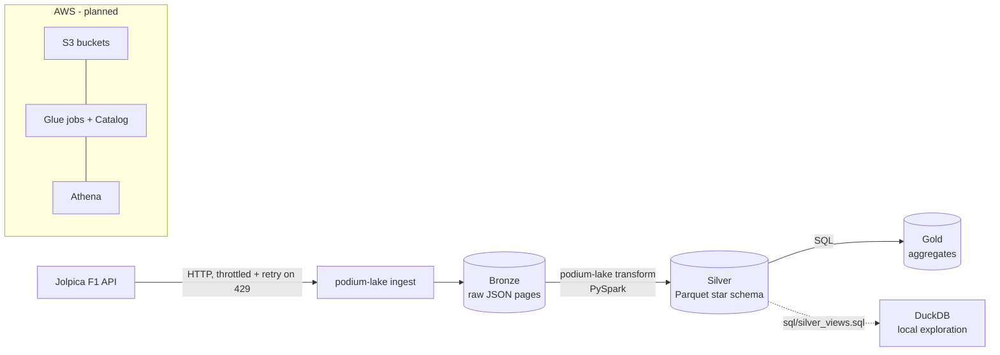
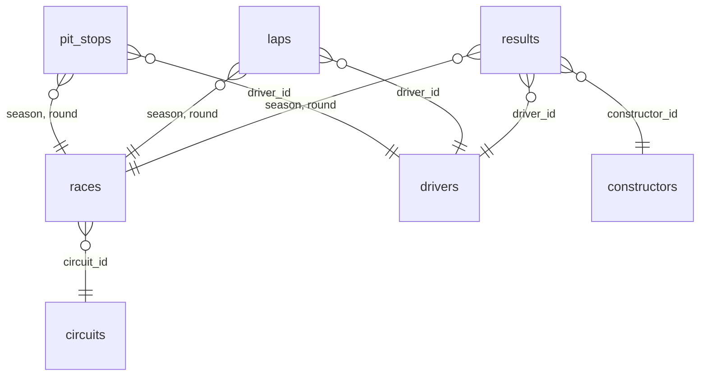

# Podium Lake

A Formula 1 data lake built on a medallion architecture (bronze → silver → gold).
It ingests historical F1 data from the [Jolpica API](https://github.com/jolpica/jolpica-f1)
(the Ergast-compatible successor) and turns it into analytics-ready tables.

| Layer  | Status     | Content                                                          |
|--------|------------|------------------------------------------------------------------|
| Bronze | ✅ Done    | Raw API pages as JSON, partitioned by season (and round)         |
| Silver | ✅ Done    | Typed star schema in Parquet: 3 facts + 4 dimensions (PySpark)   |
| Gold   | 📋 Planned | Aggregated tables for analysis, queried with SQL                 |

Endpoints ingested: `drivers`, `constructors`, `races`, `results`, `laps` (1996+), `pitstops` (2011+).

## Architecture



### Bronze

```
data/bronze/jolpica/
├── drivers/season=2024/page_000.json, _SUCCESS
└── laps/season=2024/round=01/page_000.json, page_001.json, ..., _SUCCESS
```

Each page is the API's `MRData` object, untouched.

### Silver



| Table | Type | Grain (unique key) | Main columns |
|---|---|---|---|
| `results` | fact | season, round, driver_id | constructor_id, grid, position, position_text, finished, points, laps, status, race_time_ms, fastest_lap_* |
| `laps` | fact | season, round, driver_id, lap | position, lap_time_ms |
| `pit_stops` | fact | season, round, driver_id, stop | lap, time_of_day, duration_ms |
| `races` | dim | season, round | race_name, date, time, circuit_id |
| `circuits` | dim | circuit_id | circuit_name, locality, country, lat, long |
| `drivers` | dim | driver_id | code, permanent_number, given_name, family_name, date_of_birth, nationality |
| `constructors` | dim | constructor_id | name, nationality |

```
data/silver/
├── results/season=2026/part-*.parquet     # facts: one file per season
├── laps/season=2026/...
├── pit_stops/season=2026/...
└── races/part-*.parquet                   # dims: one file, no partitions
```

**Nullable columns.** Nulls in silver mean "unknown" or "not applicable", never a failed
cast (Spark 4's ANSI mode makes a malformed value fail the run). Key columns are never null.

| Column | Null when |
|---|---|
| `results.race_time_ms` | the driver was not classified (retired, did not start) |
| `results.fastest_lap_*` | the driver did not start or retired before a timed lap |
| `drivers.code`, `permanent_number`, `date_of_birth`, `nationality` | reserve / practice-only drivers: the API only sends their id and name |

Code layout (`src/podium_lake/silver/`): `schemas.py` (bronze schemas), `columns.py`
(`dedupe`, `to_millis`), `facts.py`, `dimensions.py`, `tables.py` (table registry),
`runner.py` (`build_silver`), `spark.py` (local session).

## Running locally

Requirements: Python 3.14, [uv](https://docs.astral.sh/uv/) and Java 17+ (for PySpark).

```bash
uv sync
cp .env.example .env   # set API_URL=https://api.jolpi.ca/ergast/f1

# One endpoint, one season (defaults to 2026)
uv run podium-lake ingest drivers --from 2024

# Every endpoint over a range of seasons
uv run podium-lake ingest all --from 2020 --to 2025 -v

# Discard what is saved and download again
uv run podium-lake ingest results --from 2024 --force
```

The command exits with code `1` if any round failed, so it can simply be re-run
until it completes — already-downloaded pages are never requested again.

Build the silver tables (`data/silver/`) and explore them with
[DuckDB](https://duckdb.org/docs/installation/) (`brew install duckdb`):

```bash
uv run podium-lake transform

duckdb -init sql/silver_views.sql   # one view per table: results, laps, drivers, ...
```

```sql
select d.family_name, sum(r.points) as pts
from results r join drivers d using (driver_id)
where season = 2026
group by all order by pts desc;
```

Tests (no network needed; `tests/make_sample.py` generates a synthetic bronze with
overlapping pages, also runnable as `uv run python tests/make_sample.py <dir>`):

```bash
uv run pytest
```

## Running on AWS

> Planned — `terraform/` and `glue/` are placeholders for now.

The intended setup:

1. `terraform apply` in `terraform/` provisions the S3 bucket(s) for bronze/silver/gold,
   the Glue Data Catalog database and IAM roles.
2. Ingestion writes bronze pages to S3 (via `boto3`) instead of `data/`.
3. A Glue job calls `build_silver(spark, "s3://.../bronze/jolpica", "s3://.../silver")`
   unchanged: it takes plain path strings and never touches the local filesystem.
4. Gold tables are defined in `sql/` and queried with Athena.

## Technical decisions

### Bronze

- **Medallion architecture.** Bronze stores the API response untouched, so silver can
  be rebuilt at any time without hitting the API again.
- **Raw pages, not flattened rows, in bronze.** Jolpica's `total` counts rows that do
  not always match the items in a page (e.g. results nested inside races), so pages are
  saved as-is and parsing is left to the silver stage.
- **Resumable, idempotent ingestion.** Each page is its own file, written atomically
  (temp file + `os.replace`). A `_SUCCESS` marker is written last, so complete folders
  are skipped and partial ones resume from the last saved page. `--force` starts over.
- **Respecting the API's rate limit.** Requests are throttled (≥ 0.3 s apart) and HTTP 429
  is retried up to 5 times, honouring `Retry-After` or falling back to exponential backoff.
  A failing round is logged and reported without stopping the rest of the season.
- **Rounds derived from bronze.** Per-round endpoints (`laps`, `pitstops`) read the round
  list from the `races` data on disk, fetching it first if missing — no extra requests.
- **Endpoint registry.** Endpoints are declared in one place (`ingest/endpoints.py`) with
  their addressing rules and first available season; the CLI and runner are generic.

### Silver

- **Star schema: facts separate from dimensions.** Facts are events that grow every race;
  dimensions describe entities and change rarely. Splitting them avoids repeating driver
  and circuit attributes on every row and lets a dimension be corrected on its own.
  `constructor_id` lives on `results`, not on `drivers`, because drivers change teams.
- **Dimensions from their own endpoints.** `drivers`, `constructors` and `races`/`circuits`
  come from the canonical endpoints, not from what is nested in `results`.
- **Dedupe with `row_number()`.** The API paginates by nested rows, so a race (or a lap)
  is split across pages and its fields repeat. Every table keeps one row per key, preferring
  the latest page (ordered by source file path) so the result is deterministic.
- **Declared bronze schemas.** Every leaf is a string in the API and some fields only exist
  in some seasons (e.g. `FastestLap`); declaring the schema makes missing fields resolve to
  null instead of failing, and skips schema inference.
- **Season and round read from the JSON**, cast to int, not from folder names.
- **Only facts are partitioned, by season.** Queries filter by season, so partition pruning
  pays off; dimensions are tiny and partitioning them would only create small files. Facts
  are repartitioned before writing so each season is a single file.
- **Why not partition by round too.** ~22× more folders and files per season, each a few KB:
  the small-files problem (slow S3 listing, Glue/Athena overhead) for little pruning gain.
- **Times in milliseconds.** Lap and pit-stop times (`"1:31.929"`) are parsed into integers
  with native Spark functions (no Python UDF), so they can be summed and compared.
- **Offline tests.** A synthetic bronze (3 seasons × 22 races × 20 drivers, overlapping
  pages) checks that `results` has exactly 1,320 rows, keys are unique, types are right,
  every fact references an existing dimension row, and only facts are partitioned.

### Tooling

- `uv` for dependencies, `pydantic-settings` for configuration via `.env`,
  standard-library `argparse` and `logging` to keep the CLI dependency-free.
- DuckDB over the silver Parquet files for local exploration (`sql/silver_views.sql`).
