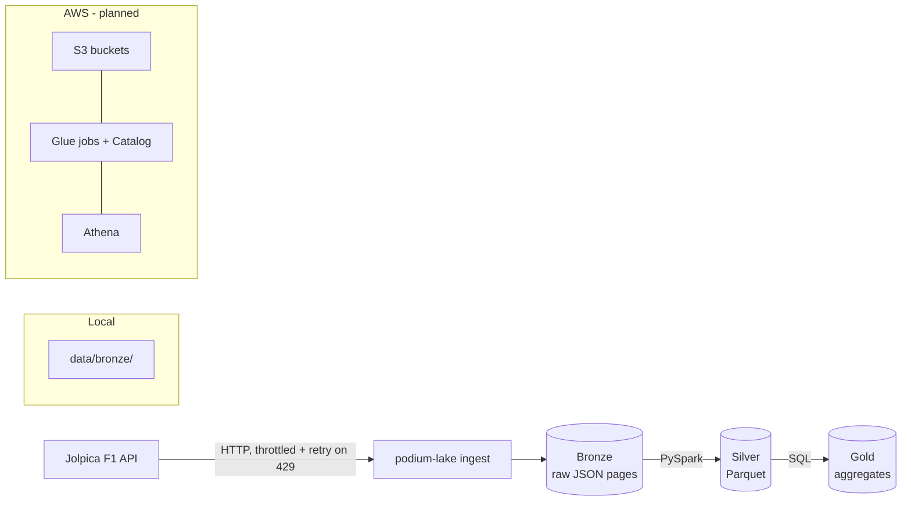

# Podium Lake

A Formula 1 data lake built on a medallion architecture (bronze → silver → gold).
It ingests historical F1 data from the [Jolpica API](https://github.com/jolpica/jolpica-f1)
(the Ergast-compatible successor) and turns it into analytics-ready tables.

| Layer  | Status         | Content                                                        |
|--------|----------------|----------------------------------------------------------------|
| Bronze | ✅ Done        | Raw API pages as JSON, partitioned by season (and round)       |
| Silver | 🚧 In progress | Cleaned, typed tables (PySpark → Parquet)                      |
| Gold   | 📋 Planned     | Aggregated tables for analysis, queried with SQL               |

Endpoints ingested: `drivers`, `constructors`, `races`, `results`, `laps` (1996+), `pitstops` (2011+).

## Architecture



Bronze layout (Hive-style partitions, so Spark/Glue can discover them):

```
data/bronze/jolpica/
├── drivers/season=2024/page_000.json, _SUCCESS
└── laps/season=2024/round=01/page_000.json, page_001.json, ..., _SUCCESS
```

## Running locally

Requirements: Python 3.14 and [uv](https://docs.astral.sh/uv/). Java is needed for the PySpark stage.

```bash
uv sync
cp .env.example .env   # set API_URL=https://api.jolpi.ca/ergast/f1

# One endpoint, one season (defaults to 2026)
uv run podium-lake ingest drivers --from 2024

# Every endpoint over a range of seasons
uv run podium-lake ingest all --from 2020 --to 2025 -v

# Discard what is saved and download again
uv run podium-lake ingest results --from 2024 --force
```

The command exits with code `1` if any round failed, so it can simply be re-run
until it completes — already-downloaded pages are never requested again.

Build the silver Parquet tables (`data/silver/`) and explore them with
[DuckDB](https://duckdb.org/docs/installation/) (`brew install duckdb`):

```bash
uv run podium-lake transform

duckdb -init sql/silver_views.sql   # one view per table: results, laps, drivers, ...
```

```sql
select d.family_name, sum(r.points) as pts
from results r join drivers d using (driver_id)
where season = 2026
group by all order by pts desc;
```

Tests:

```bash
uv run pytest
```

## Running on AWS

> Planned — the `terraform/`, `glue/` and `sql/` directories are placeholders for now.

The intended setup:

1. `terraform apply` in `terraform/` provisions the S3 bucket(s) for bronze/silver/gold,
   the Glue Data Catalog database and IAM roles.
2. Ingestion writes bronze pages to S3 (via `boto3`) instead of `data/`.
3. Glue jobs (`glue/`) run the PySpark silver transforms.
4. Gold tables are defined in `sql/` and queried with Athena.

## Technical decisions

- **Medallion architecture.** Bronze stores the API response untouched, so silver can
  be rebuilt at any time without hitting the API again.
- **Raw pages, not flattened rows, in bronze.** Jolpica's `total` counts rows that do
  not always match the items in a page (e.g. results nested inside races), so pages are
  saved as-is and parsing is left to the transform stage.
- **Resumable, idempotent ingestion.** Each page is its own file, written atomically
  (temp file + `os.replace`). A `_SUCCESS` marker is written last, so complete folders
  are skipped and partial ones resume from the last saved page. `--force` starts over.
- **Respecting the API's rate limit.** Requests are throttled (≥ 0.3 s apart) and HTTP 429
  is retried up to 5 times, honouring `Retry-After` or falling back to exponential backoff.
  A failing round is logged and reported without stopping the rest of the season.
- **Rounds derived from bronze.** Per-round endpoints (`laps`, `pitstops`) read the round
  list from the `races` data on disk, fetching it first if missing — no extra requests.
- **Hive-style partitions** (`season=YYYY/round=NN`) to match what Spark and Glue expect.
- **Endpoint registry.** Endpoints are declared in one place (`ingest/endpoints.py`) with
  their addressing rules and first available season; the CLI and runner are generic.
- **Tooling.** `uv` for dependencies, `pydantic-settings` for configuration via `.env`,
  standard-library `argparse` and `logging` to keep the CLI dependency-free.
